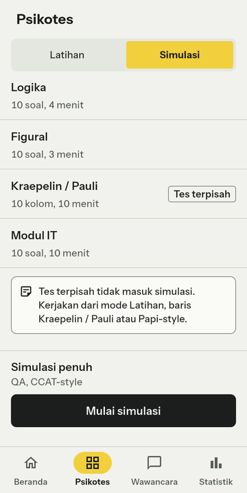
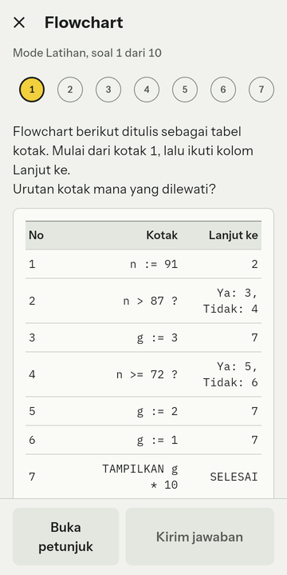
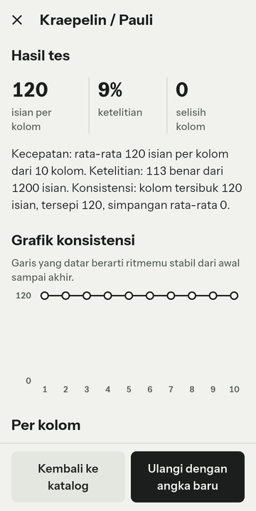
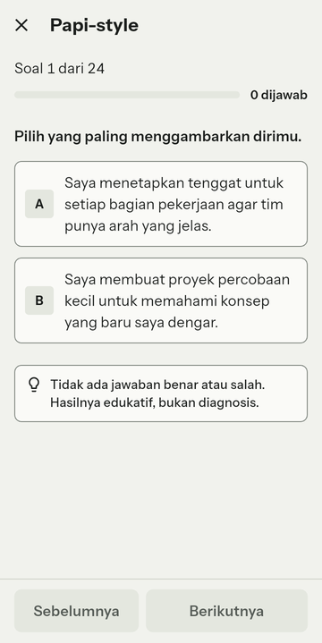
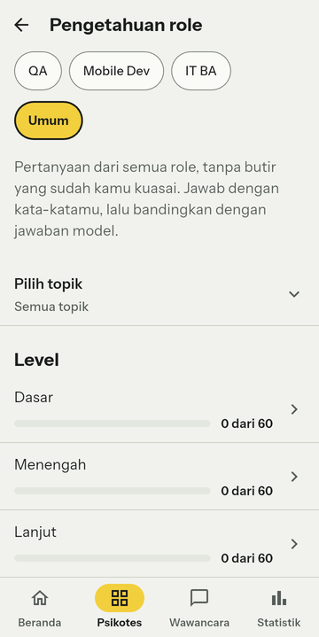

# Simulator Psikotes IT

App Flutter offline-first untuk berlatih psikotes kerja IT. Soal dibuat ulang dari seed setiap sesi, termasuk soal bergambar, dan latihan disusun dari role yang dilamar. Gratis, tanpa akun, semua data tinggal di perangkat.

Status: fitur psikotes selesai dan sudah dicoba di satu HP Android; belum dirilis (v1.0.0 menunggu langkah pemilik, lihat [docs/RILIS-APK.md](docs/RILIS-APK.md)). Belum ada pengguna selain pembuatnya.

## Masalah dan target pengguna

Pelamar IT fresh graduate (QA, Mobile Developer, IT BA) menghadapi psikotes dengan format beragam: numerik, verbal, deret, figural, Kraepelin/Pauli, kepribadian. Bahan latihan yang ada punya tiga kelemahan: bank soal tetap sehingga yang terlatih adalah hafalan; soal bergambar sering dikunci berbayar; dan latihan generik, tidak disusun dari role atau kelemahan pribadi. Target pengguna saat ini satu orang: pembuatnya sendiri, yang sedang melamar (PRD: [docs/01-prd.md](docs/01-prd.md)).

## Ukuran nilai (hipotesis, belum teruji)

Hipotesis: berlatih dengan soal yang selalu baru dan disusun dari kelemahan pribadi menaikkan skor simulasi lebih cepat daripada berlatih dengan bank tetap. Ukurannya: skor simulasi penuh (persen benar) dan median waktu per soal.

Cara menguji: kerjakan satu simulasi penuh sebelum mulai (titik awal), latihan 5 sesi x 15 menit per minggu, ulangi simulasi tiap minggu selama 4 minggu. Karena simulasi memakai seed baru tiap kali, kenaikan skor tidak bisa berasal dari menghafal soal yang sama. Target awal di PRD: naik 15 poin persen dalam 4 minggu. Data dicatat di [docs/10-laporan-hasil.md](docs/10-laporan-hasil.md); tabelnya masih kosong. Dengan n = 1 dan tanpa kelompok pembanding, hasilnya paling jauh menunjukkan bahwa app berguna bagi satu orang, bukan bahwa hipotesis umum benar.

## Demo

Video demo: (tautan diisi pemilik)

| | | |
|---|---|---|
|  |  |  |
| Simulasi per subtes | Soal flowchart (Modul IT) | Hasil Kraepelin/Pauli |
|  |  | |
| Papi-style | Pengetahuan role | |

Tangkapan layar dari HP Android (uji perangkat putaran 2, 2026-10-27), bilah status dipangkas.

## Keputusan arsitektur dan trade-off

Daftar lengkap: [docs/09-keputusan.md](docs/09-keputusan.md) (16 ADR).

- **Offline-first tanpa kunci API.** Psikotes sepenuhnya jalan di perangkat; biaya proyek Rp0 dan tidak ada akun, server, atau telemetri. Harganya: konten yang butuh LLM harus dibuat sebelum rilis, bukan saat dipakai (ADR-12).
- **Engine soal Dart murni dan deterministik** (`packages/question_engine`, ADR-02, ADR-03). Tanpa `package:flutter`, tanpa I/O, semua keacakan lewat `Rng` buatan sendiri. Soal tidak disimpan utuh, hanya `(tipe, seed, kesulitan, versi generator)`, sehingga sesi lama bisa dibuat ulang persis dan engine bisa diuji tanpa UI. Harganya: mengubah generator berarti menaikkan versi generator agar soal lama tetap sama.
- **Satu jawaban benar dibuktikan solver.** Setiap tipe punya solver terpisah dari generator; property test menjalankan 10.000 seed per tipe dan kesulitan. Kegagalan diperbaiki di generator, invarian tidak dilonggarkan.
- **Soal verbal dari `claude -p`, bukan dari engine.** Sinonim dan analogi dalam bahasa Indonesia tidak bisa dibuat prosedural dengan jujur, jadi bank 300 soal dibuat sekali lewat langganan, lalu diperiksa dua pass (pass 2 menjawab tanpa melihat kunci; yang beda atau ambigu dibuang). Batasannya: kedua pass memakai model yang sama, jadi ini bukan pemeriksa independen (ADR-04, ADR-12).
- **Flutter** (ADR-01): satu basis kode untuk Android dan web, dan stack yang sudah dikuasai pembuatnya. Trade-off: web memakai SQLite WASM (Drift) yang butuh dua berkas tambahan dari `tool/prepare_web.sh`, dan golden test hanya stabil di Linux (ADR-13).
- **Wawancara AI baru berupa layar dengan data contoh.** Layar S15 sampai S17 (pilih pewawancara, percakapan, laporan) sudah ada, tetapi diisi `FakeCoach` dan diberi label "Data contoh". Sengaja: wawancara bergantung pada layanan luar dan key milik pengguna, jadi dikerjakan paling akhir setelah psikotes diuji (ADR-11).

## Evaluasi (angka terukur dari repo)

| Ukuran | Angka | Cara memeriksa |
|---|---|---|
| Test app Flutter (tanpa golden) | 1.343 lulus | `flutter test --exclude-tags golden` |
| Test engine | 655 eksekusi lulus (VM dan Chrome) | `cd packages/question_engine && dart test -p vm,chrome` |
| Test skrip bank | 50 test, 49 lulus lokal (satu test bergantung pada folder `out/` lokal dan lulus di CI) | `python -m unittest discover -s tool/pregenerate -p "test_*.py"` |
| Tipe soal prosedural | 11 | `packages/question_engine/lib/src/registry.dart` |
| Property test | 33 sapuan (11 tipe x 3 kesulitan) x 10.000 seed = 330.000 soal per platform, masing-masing lolos pemeriksaan invarian | keluaran `dart test` di atas, `test/support/property_harness.dart` |
| Bank verbal | 300 soal; 380 kandidat, 352 lolos pass 2, 28 gugur | [docs/eval/laporan-bank.md](docs/eval/laporan-bank.md) |
| Bank pengetahuan role | 180 butir (3 role x 3 level x 20); 245 kandidat, 240 lolos, 5 gugur | [docs/eval/laporan-bank.md](docs/eval/laporan-bank.md) |
| Pool kepribadian | 96 pernyataan (8 sifat x 12) | [docs/eval/laporan-bank.md](docs/eval/laporan-bank.md) |
| Ukuran APK rilis | 58,1 MB (60.919.686 byte), ditandatangani kunci debug karena keystore belum dibuat | `flutter build apk --release` |
| Analisis statis | 0 masalah | `flutter analyze` |
| Uji HP (Xiaomi, MIUI, 720 x 1600) | Putaran 2: semua butir daftar uji diperiksa pada skala huruf 1,0, 1,3, dan 2,0 kecuali yang tercatat belum; empat temuan (panel keluar sesi, Kraepelin, petunjuk tabel flowchart, judul laporan wawancara) diperbaiki dan diuji ulang | `docs/progress.md` bagian "Catatan lanjut"; `uji-perangkat/LAPORAN-3.md` (lokal, tidak di-commit) |

Pada satu run `dart test` engine yang berjalan bersamaan dengan build APK, satu test gagal; penyebabnya tidak sempat diperiksa, dan run ulang tanpa beban lulus semua. Test yang bergantung pada waktu (batas 50 ms per soal) bisa goyah di mesin yang sibuk.

## Batasan

- Semua butir bank pengetahuan bertanda "perlu verifikasi": rujukannya belum dicocokkan dengan teks aslinya, dan kedua pass dikerjakan model yang sama.
- Bank verbal belum diperiksa manual oleh pemilik (sampel 30 soal di `docs/eval/verbal_sample.md` belum diperiksa).
- Bank bacaan (30 soal VRB-RC) sudah dibundel tetapi belum dipakai app.
- Tema gelap dan OCR untuk Capture belum ada.
- Wawancara AI belum berfungsi; yang ada hanya layar dengan data contoh.
- Belum ada pengguna nyata. Tidak ada klaim tentang pengguna, pendapatan, atau dampak.
- Di browser, tampilan layar belum diverifikasi (hanya pemuatan aset); uji HP hanya di satu perangkat Android.
- Golden test dirujuk ke Linux dan dilewati di Windows.
- Berkas lisensi belum ada; pemilihan lisensi menunggu pemilik (Q6 di `docs/11-asumsi-dan-pertanyaan.md`).

## Isi repo

| Folder | Isi |
|---|---|
| `docs/` | PRD, arsitektur, data model, sistem desain, spek layar, bank konten, rencana tugas, rencana tes, keputusan |
| `lib/` | App Flutter (tema, komponen, data, domain, layar) |
| `integration_test/` | Tiga alur utama (lihat `integration_test/README.md`) |
| `packages/question_engine/` | Engine soal Dart murni dan tesnya |
| `tool/` | Skrip pembuat bank soal, pembuat ikon, pemeriksa token, pemeriksa rilis |
| `assets/` | Font dan bank soal terbundel |

## Menjalankan

Butuh Flutter stabil dan Dart yang menyertainya. Di Windows, `sqlite3.dll` harus ada di PATH untuk test database.

```
flutter pub get
dart run build_runner build
flutter analyze
flutter test --exclude-tags golden
bash tool/run_integration.sh
cd packages/question_engine && dart pub get && dart test -p vm,chrome
```

Web: `bash tool/prepare_web.sh` lalu `flutter run -d chrome`. APK: `flutter build apk --release` (penandatanganan dan rilis: [docs/RILIS-APK.md](docs/RILIS-APK.md)). Detail perintah rutin ada di `CLAUDE.md`.

## Catatan hukum

App ini tidak berafiliasi dengan SHL, Criteria, atau penerbit tes mana pun. Soal dibuat dari generator sendiri dan hanya meniru format, durasi, dan gaya. Interpretasi kepribadian bersifat edukatif, bukan diagnosis.
